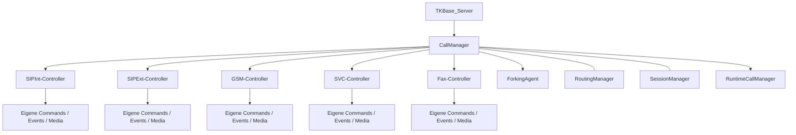

# TKBase_CallManager – Aufgabe und Satelliten

Stand: 05.11.2026. Grundlage: aktueller Quellcode im Git-Repository und die vorhandenen UML-Unterlagen.

> **Entwicklungsstand:** Der TK-Server befindet sich im Aufbau und ist noch nicht zu 100 % einsatzbereit. Vorhandene Methoden und aktive Konfiguration bedeuten keine vollständige Funktions- oder Produktionsfreigabe.

## Rolle des Managers

Zentrale Gesprächskoordination unterhalb von TKBase_Server. Er verteilt Gesprächs-Signalisierung an die Bereichscontroller, verbindet Routing- und Sessionkontext und koordiniert Forking sowie Service-/GSM-/Fax-Übergänge.

## Bezug zu den UML-Unterlagen

- [SessionManager.md](../UML/SessionManager.md)
- [event.hoch.command.runter.md](../UML/event.hoch.command.runter.md)
- [beispiel-call.md](../UML/beispiel-call.md)

Die UML beschreibt die vorgesehene Struktur. Die folgenden Ist-Angaben sind gesondert am Code geprüft. Ein „Satellit“ kann hier ein Bereichsbaustein, ein Datenmodell oder ein Hilfsbaustein sein; die Beziehungsspalte sagt ausdrücklich, ob er direkt verwendet, aufgerufen oder nur fachlich beteiligt ist.

## Satelliten und Beziehungen

| Datei / Baustein | Beziehung zum Manager | Aufgabe im Zusammenspiel |
|---|---|---|
| [TKSipInt_CallController.cs](../../SRC/SipInt/TKSipInt_CallController.cs) | Direkt erzeugter Bereichscontroller | Interne SIP-Gesprächsabläufe mit eigenen Commands, Events und Medienpfaden. |
| [TKSipExt_CallController.cs](../../SRC/SipExt/TKSipExt_CallController.cs) | Direkt erzeugter Bereichscontroller | Externe SIP-/Provider-Gesprächsabläufe. |
| [TKGSM_CallController.cs](../../SRC/GSM/TKGSM_CallController.cs) | Direkt erzeugter Bereichscontroller | GSM-Gesprächsabläufe und zugehörige GSM-Medienpfade. |
| [TKSVC_CallController.cs](../../SRC/SVC/TKSVC_CallController.cs) | Direkt erzeugter Bereichscontroller | Service-Leg-D-Abläufe einschließlich Menü, DTMF und Service-Media. |
| [TKFax_CallController.cs](../../SRC/FAX/TKFax_CallController.cs) | Direkt erzeugter zusätzlicher Bereichscontroller | Fax-Gesprächsabläufe; zusätzlich zum vierteiligen älteren UML-Bild. |
| [TKBase_CallManagerForkingAgent.cs](../../SRC/BASE/TKBase_CallManagerForkingAgent.cs) | Direkter koordinierender Satellit | Leg-B-Branches, Gewinnerentscheidung und Beenden anderer Branches; die Legs werden über den SessionManager angelegt. |
| [TKBase_SessionManager.cs](../../SRC/BASE/TKBase_SessionManager.cs) | Übergebener zentraler Partner | Erzeugt und hält den gemeinsamen Session-/Leg-Kontext. |
| [TKBase_RoutingManager.cs](../../SRC/BASE/TKBase_RoutingManager.cs) | Übergebener zentraler Partner | Liefert fachliche Zielentscheidung und Wege. |
| [TKBase_RuntimeCallManager.cs](../../SRC/BASE/TKBase_RuntimeCallManager.cs) | Live-Daten-Partner | Schreibt Live-Gesprächszustand und Gesprächshistorie. |
| [TKBase_GsmGateway.cs](../../SRC/BASE/TKBase_GsmGateway.cs) | Ereignisquelle | CallStateChanged wird im CallManager abonniert; GSM-Ereignisse fließen in den Gesprächsablauf. |

## Strukturelle Ansicht

Die Darstellung zeigt Zuständigkeiten und Daten-/Aufrufrichtungen. Sie behauptet keinen universellen Event-Bus und keine identische Implementierung aller Bereiche.

## Vorhandene Schnittstellen

- `HandleIncomingRequestAsync(...)`
- `HandleIncomingResponseAsync(...)`
- `BindTransport(...)`
- `HangupSessionAsync(...)`
- `HangupAreaSessionsAsync(...)`
- `StopOwnedSessions(...)`

Die vollständigen Parameter und Sichtbarkeiten stehen in [TKBase_CallManager.cs](../../SRC/BASE/TKBase_CallManager.cs). Die Liste nennt die für diese Rolle wesentlichen Methoden, nicht automatisch alle privaten Hilfsfunktionen.

## Typischer Ablauf

1. TKBase_Server übergibt Nicht-REGISTER-Requests und SIP-Antworten an den CallManager.
2. Dieser ordnet INVITE, ACK, BYE, CANCEL, INFO und Antworten dem richtigen Gesprächspfad zu.
3. RoutingManager und SessionManager liefern Entscheidung und gemeinsamen Kontext; Bereichscontroller bearbeiten die eigenen Legs.
4. Bei mehreren internen Zielkontakten koordiniert der ForkingAgent getrennte Leg-B-Branches; der erfolgreiche Branch gewinnt.
5. GSM-Gateway-Ereignisse, Serviceaktionen und Auflegeanforderungen werden mit dem Sessionkontext verknüpft.
6. Live-/Historienänderungen werden über die RuntimeCall-Verwaltung weitergegeben.

## Im aktuellen Code nachgewiesen

- Der Konstruktor erzeugt die fünf Bereichscontroller und den ForkingAgent. Er hält außerdem interne SIP-Commands/-Events/-Media sowie SIPExt-Commands für koordinierte Pfade.
- Die Satelliten unter einem Bereichscontroller sind dessen bereichseigene Commands-, Events- und Media-Klassen; der Dateiname kann singular sein, obwohl der Klassenname plural ist.
- Die gegenwärtige Ereignisvermittlung ist nicht ausschließlich auf einen neutralen SessionManager konzentriert. Die CallManager-Datei enthält konkrete Service- und GSM-Inbound-Brückenpfade.

## Zuständigkeitsgrenzen und Soll-Ist-Abgleich

- Die UML-Regel „Commands nach unten, Events nach oben“ bleibt die Orientierung für die Bereichstrennung. Sie ist kein Beleg für ein bereits durchgehend vereinheitlichtes Event-Bussystem.
- Ein Bereichscontroller darf fachlich nur seine eigenen Legs steuern. Bereichsübergreifende Zusammenführung gehört in die zentrale Koordination.
- Routing entscheidet den Weg; Sessionverwaltung hält den Kontext; CallManager/Controller führen den Gesprächsablauf aus.

## Daten und Laufzeitzustand

RuntimeCall und SIP_CallLog über den RuntimeCallManager; Routing-, Benutzer- und Registrierungsdaten über die zentralen SQL-/Routingpfade.

## Zusammenhang mit den übrigen Managern

- [TKBase_RegistrationManager](TKBase_RegistrationManager_DOKU_AKTUELL.md)
- [TKBase_RoutingManager](TKBase_RoutingManager_DOKU_AKTUELL.md)
- [TKBase_SessionManager](TKBase_SessionManager_DOKU_AKTUELL.md)
- [TKBase_RuntimeCallManager](TKBase_RuntimeCallManager_DOKU_AKTUELL.md)
- [TKBase_MediaManager](TKBase_MediaManager_DOKU_AKTUELL.md)
- [TKBase_DTMF_Manager](TKBase_DTMF_Manager_DOKU_AKTUELL.md)
- [TKBase_LogManager](TKBase_LogManager_DOKU_AKTUELL.md)

## Quellen und Prüfumfang

- Manager: [TKBase_CallManager.cs](../../SRC/BASE/TKBase_CallManager.cs)
- Satelliten: die oben einzeln verlinkten Dateien.
- Geprüft wurden vorhandene Klassen/Methoden, Konstruktorabhängigkeiten und relevante Aufrufstellen. Ein Laufzeit-, Telefonie- oder Installationstest war nicht Teil dieser Dokumentationsarbeit.
- Bestehende UMLs, Dateien unter Alt und Quellcode wurden nicht verändert. Offene Trennungen werden beschrieben und nicht stillschweigend als erledigt dargestellt.
