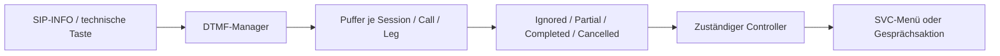

# TKBase_DTMF_Manager – Aufgabe und Satelliten

Stand: 05.11.2026. Grundlage: aktueller Quellcode im Git-Repository und die vorhandenen UML-Unterlagen.

> **Entwicklungsstand:** Der TK-Server befindet sich im Aufbau und ist noch nicht zu 100 % einsatzbereit. Vorhandene Methoden und aktive Konfiguration bedeuten keine vollständige Funktions- oder Produktionsfreigabe.

## Rolle des Managers

Technische Normalisierung und Pufferung von DTMF-Tastenfolgen pro Session/Call/Leg. Er liefert strukturierte Eingabeergebnisse; die fachliche Bedeutung einer abgeschlossenen Folge legt die zuständige Gesprächs-/Servicefunktion fest.

## Bezug zu den UML-Unterlagen

Für diesen Manager liegt im UML-Ordner derzeit kein eigenes Diagramm vor. Seine Rolle und die aufgeführten Beziehungen stammen aus dem vorhandenen Quellcode.

Die UML beschreibt die vorgesehene Struktur. Die folgenden Ist-Angaben sind gesondert am Code geprüft. Ein „Satellit“ kann hier ein Bereichsbaustein, ein Datenmodell oder ein Hilfsbaustein sein; die Beziehungsspalte sagt ausdrücklich, ob er direkt verwendet, aufgerufen oder nur fachlich beteiligt ist.

## Satelliten und Beziehungen

| Datei / Baustein | Beziehung zum Manager | Aufgabe im Zusammenspiel |
|---|---|---|
| [TKSipInt_CallController.cs](../../SRC/SipInt/TKSipInt_CallController.cs) | Aufrufer / DTMF-Nutzer | Verarbeitet interne Signalisierung und nutzt den DTMF-Baustein. |
| [TKSVC_CallController.cs](../../SRC/SVC/TKSVC_CallController.cs) | Aufrufer / Service-Nutzer | Verwendet DTMF-Eingaben im Kontext des Serviceablaufs. |
| [TKSVC_Media.cs](../../SRC/SVC/TKSVC_Media.cs) | Technische Eingabequelle / Nutzer | Kann DTMF-Ereignisse in den Manager einspeisen. |
| [TKSVC_Menu.cs](../../SRC/SVC/TKSVC_Menu.cs) | Fachlicher Menüpartner, kein direkt erzeugtes Manager-Unterobjekt | Wertet im Servicebereich Menüzustände und Auswahl aus. |
| [TKBase_LogManager.cs](../../SRC/BASE/TKBase_LogManager.cs) | Übergebener gemeinsamer Partner | Protokolliert normalisierte Eingaben und abgeschlossene Folgen. |

## Strukturelle Ansicht

Die Darstellung zeigt Zuständigkeiten und Daten-/Aufrufrichtungen. Sie behauptet keinen universellen Event-Bus und keine identische Implementierung aller Bereiche.

## Vorhandene Schnittstellen

- `TryParseSipInfoDigit(...)`
- `PushDigit(...)`
- `Clear(...)`

Die vollständigen Parameter und Sichtbarkeiten stehen in [TKBase_DTMF_Manager.cs](../../SRC/BASE/TKBase_DTMF_Manager.cs). Die Liste nennt die für diese Rolle wesentlichen Methoden, nicht automatisch alle privaten Hilfsfunktionen.

## Typischer Ablauf

1. Eine technische Eingabequelle liefert eine Taste und den Session-/Call-/Leg-Bezug.
2. TryParseSipInfoDigit kann eine SIP-INFO-Taste auslesen; PushDigit normalisiert und puffert die Taste.
3. Die Folge wird nach aktuellem Code bei # abgeschlossen. Ein einzelnes # ohne vorherige Folge liefert ein Cancelled-Ergebnis.
4. Nach mehr als zehn Sekunden Eingabepause wird der vorhandene Puffer bei der nächsten Eingabe zurückgesetzt.
5. Der Aufrufer erhält Ignored, Partial, Completed oder Cancelled und entscheidet im Fachkontext über die Aktion.

## Im aktuellen Code nachgewiesen

- DtmfBuffer und TKBase_DTMF_Result sind in derselben Datei definiert; sie sind technische Hilfstypen, keine selbständigen Bereichscontroller.
- Die Schlüsselbildung berücksichtigt SessionID, CallID und Legname. Mehrere Gesprächspartner dürfen deshalb nicht in einen einzigen globalen Tastenpuffer vermischt werden.
- Das technische Cancelled-Ergebnis für alleinstehendes # bestimmt noch nicht die Benutzerbedeutung in jedem Servicezustand: # kann dort beispielsweise Beenden und Speichern bedeuten.

## Zuständigkeitsgrenzen und Soll-Ist-Abgleich

- Keine eigenen Menüoptionen, Servicenummern, Zielrouten oder GSM-Kommandos als fachliche Zuständigkeit des DTMF-Managers.
- Die SVC-Fachlogik interpretiert die Eingabe im laufenden Menü-/Aufnahme-/Transferzustand.
- Keine eigene DTMF-UML vorhanden; dokumentiert ist die geprüfte technische Schnittstelle.

## Daten und Laufzeitzustand

Flüchtige, getrennte Eingabepuffer im Serviceprozess; keine eigene Datenbanktabelle.

## Zusammenhang mit den übrigen Managern

- [TKBase_RegistrationManager](TKBase_RegistrationManager_DOKU_AKTUELL.md)
- [TKBase_RoutingManager](TKBase_RoutingManager_DOKU_AKTUELL.md)
- [TKBase_SessionManager](TKBase_SessionManager_DOKU_AKTUELL.md)
- [TKBase_CallManager](TKBase_CallManager_DOKU_AKTUELL.md)
- [TKBase_RuntimeCallManager](TKBase_RuntimeCallManager_DOKU_AKTUELL.md)
- [TKBase_MediaManager](TKBase_MediaManager_DOKU_AKTUELL.md)
- [TKBase_LogManager](TKBase_LogManager_DOKU_AKTUELL.md)

## Quellen und Prüfumfang

- Manager: [TKBase_DTMF_Manager.cs](../../SRC/BASE/TKBase_DTMF_Manager.cs)
- Satelliten: die oben einzeln verlinkten Dateien.
- Geprüft wurden vorhandene Klassen/Methoden, Konstruktorabhängigkeiten und relevante Aufrufstellen. Ein Laufzeit-, Telefonie- oder Installationstest war nicht Teil dieser Dokumentationsarbeit.
- Bestehende UMLs, Dateien unter Alt und Quellcode wurden nicht verändert. Offene Trennungen werden beschrieben und nicht stillschweigend als erledigt dargestellt.
