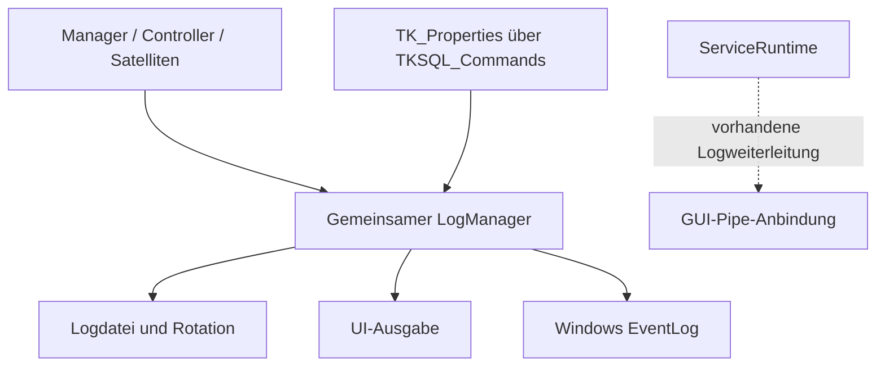

# TKBase_LogManager – Aufgabe und Satelliten

Stand: 05.11.2026. Grundlage: aktueller Quellcode im Git-Repository und die vorhandenen UML-Unterlagen.

> **Entwicklungsstand:** Der TK-Server befindet sich im Aufbau und ist noch nicht zu 100 % einsatzbereit. Vorhandene Methoden und aktive Konfiguration bedeuten keine vollständige Funktions- oder Produktionsfreigabe.

## Rolle des Managers

Gemeinsamer Protokollierungsbaustein des TK-Servers. Er filtert Meldungen, wählt Ausgabeziele und schreibt in Datei, Benutzeroberfläche oder Windows-Ereignisprotokoll. Er ist ein querschnittlicher Partner der Bereiche, nicht deren fachlicher Controller.

## Bezug zu den UML-Unterlagen

Für diesen Manager liegt im UML-Ordner derzeit kein eigenes Diagramm vor. Seine Rolle und die aufgeführten Beziehungen stammen aus dem vorhandenen Quellcode.

Die UML beschreibt die vorgesehene Struktur. Die folgenden Ist-Angaben sind gesondert am Code geprüft. Ein „Satellit“ kann hier ein Bereichsbaustein, ein Datenmodell oder ein Hilfsbaustein sein; die Beziehungsspalte sagt ausdrücklich, ob er direkt verwendet, aufgerufen oder nur fachlich beteiligt ist.

## Satelliten und Beziehungen

| Datei / Baustein | Beziehung zum Manager | Aufgabe im Zusammenspiel |
|---|---|---|
| [TKSQL_Commands.cs](../../SRC/SQL/TKSQL_Commands.cs) | Konfigurationspartner | Liest LogLevel und DebugLoggingEnabled aus TK_Properties über TryConfigureFromDatabase. |
| [TKBase_ServiceRunTime.cs](../../SRC/BASE/TKBase_ServiceRunTime.cs) | Laufzeitnutzer und Weiterleitungsstelle | Verwendet Service-Logging; kann Servicemeldungen über die vorhandene Pipe-Anbindung an die GUI weiterreichen. |
| [TKBase_GUIRunTime.cs](../../SRC/BASE/TKBase_GUIRunTime.cs) | GUI-Kommunikationspartner | GUI-seitige Service-/Pipe-Anbindung; ersetzt den Logger nicht durch einen zweiten fachlichen Zustandsbestand. |
| [TKBase_Server.cs](../../SRC/BASE/TKBase_Server.cs) | Host-/Manager-Nutzer | Übergibt bzw. verwendet den gemeinsamen Logger für die Serverbausteine. |

## Strukturelle Ansicht

Die Darstellung zeigt Zuständigkeiten und Daten-/Aufrufrichtungen. Sie behauptet keinen universellen Event-Bus und keine identische Implementierung aller Bereiche.

## Vorhandene Schnittstellen

- `Configure(...)`
- `TryConfigureFromDatabase(...)`
- `SetOutputMode(...)`
- `Info(...)`
- `Warn(...)`
- `Error(...)`
- `Debug(...)`
- `Write(...)`
- `WriteRaw(...)`
- `RotateNow(...)`

Die vollständigen Parameter und Sichtbarkeiten stehen in [TKBase_LogManager.cs](../../SRC/BASE/TKBase_LogManager.cs). Die Liste nennt die für diese Rolle wesentlichen Methoden, nicht automatisch alle privaten Hilfsfunktionen.

## Typischer Ablauf

1. Ein Manager, Controller oder Satellit meldet Text und Protokollierungsniveau.
2. Der LogManager prüft Mindestniveau und den separaten Debug-Schalter.
3. Die Zielauswahl berücksichtigt Vorgaben bzw. das Standardziel der Meldungsart.
4. Datei-, UI- oder EventLog-Ausgabe wird über den gemeinsamen Logger vorgenommen.
5. Die vorhandenen Rotationsmethoden begrenzen bzw. archivieren Logdateien nach ihrer Konfiguration.

## Im aktuellen Code nachgewiesen

- LogLevel, LogTarget, LogOutputMode sowie Rotationsoptionen sind Hilfstypen des Loggingbereichs; Datei/UI/EventLog sind Ausgabeziele, keine SIP-/GSM-Satelliten.
- Die Methoden WriteToUi, WriteToFile und WriteToEventLog sind im bestehenden Logger implementiert.
- Debug wird separat gesteuert und laut bestehender Implementierungsabsicht nicht als normale Debug-Meldung ins Windows EventLog geschrieben.
- Info/Warn/Error, Rohtextausgabe und Rotation sind im aktuellen Code vorhanden; konkrete Ausgabe hängt vom gewählten Modus und verfügbaren Rechten ab.

## Zuständigkeitsgrenzen und Soll-Ist-Abgleich

- Es wird kein neuer Logger pro Manager oder Bereich eingeführt.
- Protokollieren erzeugt keine Routingentscheidung und keine fachliche Zustandsänderung eines Gesprächs.
- Die UI-Ausgabe ist eine Darstellung von Meldungen, keine eigene Server-Runtime.

## Daten und Laufzeitzustand

TK_Properties.LogLevel und TK_Properties.DebugLoggingEnabled als Konfiguration; Logausgabe in den gewählten vorhandenen Zielen.

## Zusammenhang mit den übrigen Managern

- [TKBase_RegistrationManager](TKBase_RegistrationManager_DOKU_AKTUELL.md)
- [TKBase_RoutingManager](TKBase_RoutingManager_DOKU_AKTUELL.md)
- [TKBase_SessionManager](TKBase_SessionManager_DOKU_AKTUELL.md)
- [TKBase_CallManager](TKBase_CallManager_DOKU_AKTUELL.md)
- [TKBase_RuntimeCallManager](TKBase_RuntimeCallManager_DOKU_AKTUELL.md)
- [TKBase_MediaManager](TKBase_MediaManager_DOKU_AKTUELL.md)
- [TKBase_DTMF_Manager](TKBase_DTMF_Manager_DOKU_AKTUELL.md)

## Quellen und Prüfumfang

- Manager: [TKBase_LogManager.cs](../../SRC/BASE/TKBase_LogManager.cs)
- Satelliten: die oben einzeln verlinkten Dateien.
- Geprüft wurden vorhandene Klassen/Methoden, Konstruktorabhängigkeiten und relevante Aufrufstellen. Ein Laufzeit-, Telefonie- oder Installationstest war nicht Teil dieser Dokumentationsarbeit.
- Bestehende UMLs, Dateien unter Alt und Quellcode wurden nicht verändert. Offene Trennungen werden beschrieben und nicht stillschweigend als erledigt dargestellt.
