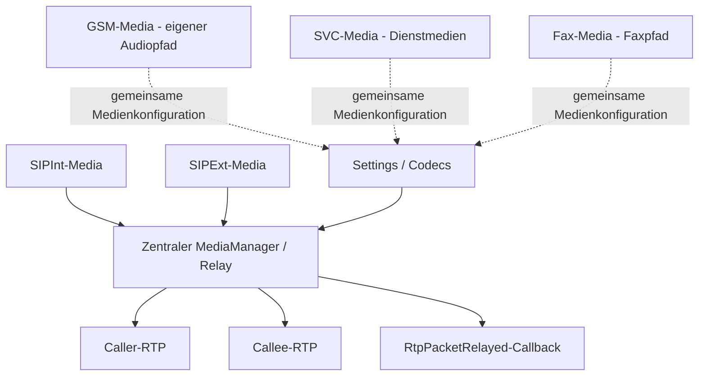

# TKBase_MediaManager – Aufgabe und Satelliten

Stand: 05.11.2026. Grundlage: aktueller Quellcode im Git-Repository und die vorhandenen UML-Unterlagen.

> **Entwicklungsstand:** Der TK-Server befindet sich im Aufbau und ist noch nicht zu 100 % einsatzbereit. Vorhandene Methoden und aktive Konfiguration bedeuten keine vollständige Funktions- oder Produktionsfreigabe.

## Rolle des Managers

Zentraler technischer Medienbaustein für RTP-Relay, Endpunktverwaltung und ergänzende SDP-/Audiohilfen. Bereichsspezifische Medienklassen verwenden oder ergänzen diese Technik; nicht alle sind direkt vom Manager erzeugte Unterobjekte.

## Bezug zu den UML-Unterlagen

Für diesen Manager liegt im UML-Ordner derzeit kein eigenes Diagramm vor. Seine Rolle und die aufgeführten Beziehungen stammen aus dem vorhandenen Quellcode.

Die UML beschreibt die vorgesehene Struktur. Die folgenden Ist-Angaben sind gesondert am Code geprüft. Ein „Satellit“ kann hier ein Bereichsbaustein, ein Datenmodell oder ein Hilfsbaustein sein; die Beziehungsspalte sagt ausdrücklich, ob er direkt verwendet, aufgerufen oder nur fachlich beteiligt ist.

## Satelliten und Beziehungen

| Datei / Baustein | Beziehung zum Manager | Aufgabe im Zusammenspiel |
|---|---|---|
| [TKSipInt_Media.cs](../../SRC/SipInt/TKSipInt_Media.cs) | Bereichsnutzer | Verwendet CreateRelay, Start, StopRelay und Release für interne SIP-Medienpfade. |
| [TKSipExt_Media.cs](../../SRC/SipExt/TKSipExt_Media.cs) | Bereichsnutzer | Verwendet den zentralen Relay-Baustein für externe SIP-Medienpfade. |
| [TKGSM_Media.cs](../../SRC/GSM/TKGSM_Media.cs) | Eigenständiger Bereichs-Medienpfad | Verbindet den GSM-Audioweg mit dem Gesprächskontext; nicht pauschal identisch mit einem SIP-zu-SIP-Relay. |
| [TKSVC_Media.cs](../../SRC/SVC/TKSVC_Media.cs) | Eigenständiger Service-Medienpfad | Serviceansagen, Medienereignisse und Aufnahme-/DTMF-Anbindung; hat eigene Bereichslogik. |
| [TKFax_Media.cs](../../SRC/FAX/TKFax_Media.cs) | Eigenständiger Fax-Medienpfad | Faxbezogene Medien-/Ressourcenbehandlung; nicht als normaler Sprachrelay gleichsetzen. |
| [TKBase_ServerSettings.cs](../../SRC/BASE/TKBase_ServerSettings.cs) | Konfigurationslieferant | Lokale/öffentliche Medienadressen und RTP-Portkonfiguration. |
| [TKBase_AudioCodecConfig.cs](../../SRC/BASE/TKBase_AudioCodecConfig.cs) | Codec-Konfigurationspartner | Beschreibt Codecparameter und die Eignung für die jeweiligen Medienpfade. |

## Strukturelle Ansicht

Die Darstellung zeigt Zuständigkeiten und Daten-/Aufrufrichtungen. Sie behauptet keinen universellen Event-Bus und keine identische Implementierung aller Bereiche.

## Vorhandene Schnittstellen

- `CreateRelay(...)`
- `SetCaller(...)`
- `SetCallee(...)`
- `Start(...)`
- `StopRelay(...)`
- `Release(...)`
- `SendPcmAnnouncementToLegAsync(...)`

Die vollständigen Parameter und Sichtbarkeiten stehen in [TKBase_MediaManager.cs](../../SRC/BASE/TKBase_MediaManager.cs). Die Liste nennt die für diese Rolle wesentlichen Methoden, nicht automatisch alle privaten Hilfsfunktionen.

## Typischer Ablauf

1. Der zuständige Bereichscontroller/-medienpfad übernimmt Session, Endpunkte, Codec- und Portinformationen.
2. Für einen zentralen Relay-Pfad wird ein Relay erzeugt und mit Caller-/Callee-Endpunkten konfiguriert.
3. Start betreibt die beiden Richtungen Caller→Callee und Callee→Caller.
4. RtpPacketRelayed kann weitergeleitete Pakete an angemeldete Nutzer melden, beispielsweise für Aufzeichnungspfade.
5. StopRelay/Dispose und die jeweilige Ressourcenfreigabe beenden den zugehörigen Medienpfad.

## Im aktuellen Code nachgewiesen

- Die Datei enthält Relay-Implementierung und zusätzliche SDP-Analyse-/Rewrite-Hilfen. Ein Dateiname steht hier nicht nur für reine fachliche Koordination.
- CreateRelay erzeugt aktuell eine neue TKBase_MediaManager-Instanz für das Relay.
- Die SDP-Hilfen analysieren Audio und Verbindungsadressen und können eine Adresse/einen Port ersetzen.
- Der konkrete Medienpfad und dessen Codecbehandlung entscheiden über Nutzbarkeit; die bloße Existenz eines Katalogeintrags beweist keinen erfolgreichen Medienbetrieb.

## Zuständigkeitsgrenzen und Soll-Ist-Abgleich

- SIP-/GSM-/Service-/Fax-Fachlogik bleibt im jeweiligen Bereich. RTP-Technik darf nicht mit fachlicher Zielauswahl verwechselt werden.
- Ein allgemeiner oder vollständiger Transcoder für sämtliche Codecs wird durch diese Dokumentation nicht zugesichert.
- Für den MediaManager gibt es aktuell keine eigene UML-Datei; die Satellitenbezüge wurden über die Verwendungsstellen im Code geprüft.

## Daten und Laufzeitzustand

Keine eigene SQL-Persistenzschicht im Manager. Er erhält seine Konfiguration aus Settings/Codecobjekten und dem Gesprächskontext.

## Zusammenhang mit den übrigen Managern

- [TKBase_RegistrationManager](TKBase_RegistrationManager_DOKU_AKTUELL.md)
- [TKBase_RoutingManager](TKBase_RoutingManager_DOKU_AKTUELL.md)
- [TKBase_SessionManager](TKBase_SessionManager_DOKU_AKTUELL.md)
- [TKBase_CallManager](TKBase_CallManager_DOKU_AKTUELL.md)
- [TKBase_RuntimeCallManager](TKBase_RuntimeCallManager_DOKU_AKTUELL.md)
- [TKBase_DTMF_Manager](TKBase_DTMF_Manager_DOKU_AKTUELL.md)
- [TKBase_LogManager](TKBase_LogManager_DOKU_AKTUELL.md)

## Quellen und Prüfumfang

- Manager: [TKBase_MediaManager.cs](../../SRC/BASE/TKBase_MediaManager.cs)
- Satelliten: die oben einzeln verlinkten Dateien.
- Geprüft wurden vorhandene Klassen/Methoden, Konstruktorabhängigkeiten und relevante Aufrufstellen. Ein Laufzeit-, Telefonie- oder Installationstest war nicht Teil dieser Dokumentationsarbeit.
- Bestehende UMLs, Dateien unter Alt und Quellcode wurden nicht verändert. Offene Trennungen werden beschrieben und nicht stillschweigend als erledigt dargestellt.
