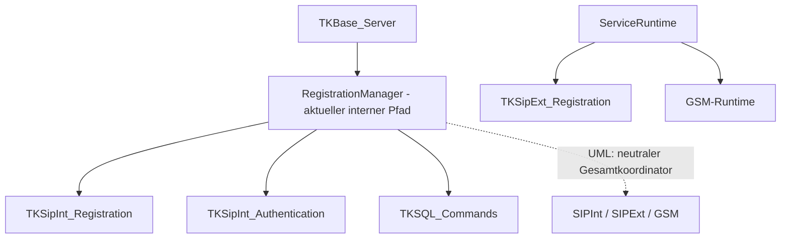

# TKBase_RegistrationManager – Aufgabe und Satelliten

Stand: 05.11.2026. Grundlage: aktueller Quellcode im Git-Repository und die vorhandenen UML-Unterlagen.

> **Entwicklungsstand:** Der TK-Server befindet sich im Aufbau und ist noch nicht zu 100 % einsatzbereit. Vorhandene Methoden und aktive Konfiguration bedeuten keine vollständige Funktions- oder Produktionsfreigabe.

## Rolle des Managers

Koordination der internen SIP-Registrierung unterhalb von TKBase_Server. Die UML sieht darüber hinaus einen neutralen Koordinator für SIPInt, SIPExt und GSM vor; diese erweiterte Rolle ist im aktuellen Code nicht vollständig verwirklicht.

## Bezug zu den UML-Unterlagen

- [RegistrationManager.md](../UML/RegistrationManager.md)

Die UML beschreibt die vorgesehene Struktur. Die folgenden Ist-Angaben sind gesondert am Code geprüft. Ein „Satellit“ kann hier ein Bereichsbaustein, ein Datenmodell oder ein Hilfsbaustein sein; die Beziehungsspalte sagt ausdrücklich, ob er direkt verwendet, aufgerufen oder nur fachlich beteiligt ist.

## Satelliten und Beziehungen

| Datei / Baustein | Beziehung zum Manager | Aufgabe im Zusammenspiel |
|---|---|---|
| [TKBase_Server.cs](../../SRC/BASE/TKBase_Server.cs) | Aufrufer / Host | Leitet eingehende REGISTER an HandleSipIntRegisterAsync weiter. |
| [TKSipInt_Registration.cs](../../SRC/SipInt/TKSipInt_Registration.cs) | Direkt verwendeter SIPInt-Satellit | Interner Registrierungs-/Legacy-Authentifizierungspfad. |
| [TKSipInt_Authentication.cs](../../SRC/SipInt/TKSipInt_Authentication.cs) | Direkt verwendeter Authentifizierungssatellit | Benutzerauflösung und Prüfung der SIP-Zugangsdaten bzw. Digest-Daten. |
| [TKSQL_Commands.cs](../../SRC/SQL/TKSQL_Commands.cs) | Direkt verwendeter Persistenzbaustein | Schreibt InternalRegistrationState und RuntimeRegistration; deaktiviert und bereinigt Registrierungen. |
| [TKSipExt_Registration.cs](../../SRC/SipExt/TKSipExt_Registration.cs) | Eigenständiger Providerbereich, nicht gleichrangig vom Manager gestarteter Satellit | Führt externe Providerregistrierungen aus; Start/Stop erfolgt derzeit über die ServiceRuntime. |
| [TKGSM_Registration.cs](../../SRC/GSM/TKGSM_Registration.cs) | Bereichsbaustein für GSM | Vorhandene GSM-Registrierungsdatei; die UML-Koordination über diesen Manager ist nicht als vollständiger gemeinsamer Start-/Stop-Pfad vorhanden. |
| [TKBase_ServiceRunTime.cs](../../SRC/BASE/TKBase_ServiceRunTime.cs) | Übergeordnete Laufzeitsteuerung | Startet Provider/GSM getrennt und setzt die freigegebenen Runtime-Bereiche. |

## Strukturelle Ansicht

Die Darstellung zeigt Zuständigkeiten und Daten-/Aufrufrichtungen. Sie behauptet keinen universellen Event-Bus und keine identische Implementierung aller Bereiche.

## Vorhandene Schnittstellen

- `HandleSipIntRegisterAsync(...)`
- `ConfigureRuntimeAreas(...)`
- `SaveInternalRegistration(...)`
- `SaveExternalRegistration(...)`
- `DeactivateInternalRegistration(...)`
- `CleanupExpiredInternalRegistrations(...)`

Die vollständigen Parameter und Sichtbarkeiten stehen in [TKBase_RegistrationManager.cs](../../SRC/BASE/TKBase_RegistrationManager.cs). Die Liste nennt die für diese Rolle wesentlichen Methoden, nicht automatisch alle privaten Hilfsfunktionen.

## Typischer Ablauf

1. TKBase_Server erkennt einen REGISTER-Request und ruft HandleSipIntRegisterAsync auf.
2. Der Manager liest Benutzer, Contact, Endpunkt und Ablaufzeit und berücksichtigt die SIPInt-Bereichsfreigabe.
3. Eine Abmeldung mit Expires=0 wird getrennt behandelt; sonst folgen Authentifizierung und gegebenenfalls Digest-Challenge.
4. Nach erfolgreicher Prüfung schreibt SaveInternalRegistration den Detailzustand und die zentrale Live-Registrierung.
5. Die Antwort wird derzeit ebenfalls im Manager erzeugt/versandt. Das zeigt die noch nicht vollständige Protokollneutralität.

## Im aktuellen Code nachgewiesen

- Der Code enthält eigene REGISTER-Antworten, Nonce-Verwaltung und Digest-Challenge-Methoden. Er ist daher aktuell nicht ausschließlich ein neutraler Verteiler.
- SaveExternalRegistration ist eine vorhandene Methode zur Spiegelung externer Laufzeitregistrierungen. Sie bedeutet nicht, dass der Manager selbst den Provider-REGISTER-Prozess betreibt.
- Die aktuelle Server-Weiterleitung behandelt alle eingehenden REGISTER zunächst über diesen internen Pfad; Providerregistrierung als Client läuft separat.

## Zuständigkeitsgrenzen und Soll-Ist-Abgleich

- Vorgabe laut UML: neutrale Koordination der drei Registrierungsbereiche, Start/Stop/Reset/Überwachung und bereichsbezogene Status-Snapshots.
- Istabweichung: Die gemeinsame Lifecycle-Koordination aller drei Bereiche ist hier nicht umgesetzt; wesentliche Protokolllogik liegt noch im Manager.
- Die UML-Dateinamen TKSipExt_Registra.cs, TKSipInt_Registra.cs und TKGSM_Registra.cs entsprechen nicht den vorhandenen Dateien mit Endung _Registration.cs.
- Keine Gesprächs-, Routing-, Leg- oder Mediensteuerung als neue Zuständigkeit ableiten.

## Daten und Laufzeitzustand

TK_SIP_User, TK_InternalRegistrationState und TK_RuntimeRegistration; Providerzustände werden durch den separaten Providerpfad gepflegt.

## Zusammenhang mit den übrigen Managern

- [TKBase_RoutingManager](TKBase_RoutingManager_DOKU_AKTUELL.md)
- [TKBase_SessionManager](TKBase_SessionManager_DOKU_AKTUELL.md)
- [TKBase_CallManager](TKBase_CallManager_DOKU_AKTUELL.md)
- [TKBase_RuntimeCallManager](TKBase_RuntimeCallManager_DOKU_AKTUELL.md)
- [TKBase_MediaManager](TKBase_MediaManager_DOKU_AKTUELL.md)
- [TKBase_DTMF_Manager](TKBase_DTMF_Manager_DOKU_AKTUELL.md)
- [TKBase_LogManager](TKBase_LogManager_DOKU_AKTUELL.md)

## Quellen und Prüfumfang

- Manager: [TKBase_RegistrationManager.cs](../../SRC/BASE/TKBase_RegistrationManager.cs)
- Satelliten: die oben einzeln verlinkten Dateien.
- Geprüft wurden vorhandene Klassen/Methoden, Konstruktorabhängigkeiten und relevante Aufrufstellen. Ein Laufzeit-, Telefonie- oder Installationstest war nicht Teil dieser Dokumentationsarbeit.
- Bestehende UMLs, Dateien unter Alt und Quellcode wurden nicht verändert. Offene Trennungen werden beschrieben und nicht stillschweigend als erledigt dargestellt.
