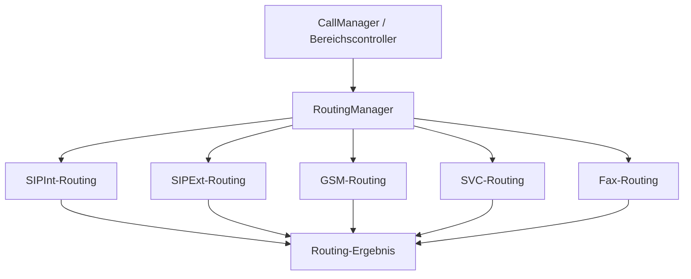

# TKBase_RoutingManager – Aufgabe und Satelliten

Stand: 05.11.2026. Grundlage: aktueller Quellcode im Git-Repository und die vorhandenen UML-Unterlagen.

> **Entwicklungsstand:** Der TK-Server befindet sich im Aufbau und ist noch nicht zu 100 % einsatzbereit. Vorhandene Methoden und aktive Konfiguration bedeuten keine vollständige Funktions- oder Produktionsfreigabe.

## Rolle des Managers

Neutraler fachlicher Koordinator für Zielklassifikation und Zielauflösung. Er bestimmt den zuständigen Bereich und liefert ein Routing-Ergebnis; die Ausführung des Gesprächs bleibt bei CallManager und Bereichscontrollern.

## Bezug zu den UML-Unterlagen

- [RoutingManager.md](../UML/RoutingManager.md)

Die UML beschreibt die vorgesehene Struktur. Die folgenden Ist-Angaben sind gesondert am Code geprüft. Ein „Satellit“ kann hier ein Bereichsbaustein, ein Datenmodell oder ein Hilfsbaustein sein; die Beziehungsspalte sagt ausdrücklich, ob er direkt verwendet, aufgerufen oder nur fachlich beteiligt ist.

## Satelliten und Beziehungen

| Datei / Baustein | Beziehung zum Manager | Aufgabe im Zusammenspiel |
|---|---|---|
| [TKSipInt_Routing.cs](../../SRC/SipInt/TKSipInt_Routing.cs) | Direkt erzeugter Bereichsrouter | Löst interne Teilnehmer und zugehörige Kontaktziele auf. |
| [TKSipExt_Routing.cs](../../SRC/SipExt/TKSipExt_Routing.cs) | Direkt erzeugter Bereichsrouter | Provider-/externe Wege sowie externe Inbound-Zuordnungen. |
| [TKGSM_Routing.cs](../../SRC/GSM/TKGSM_Routing.cs) | Direkt erzeugter Bereichsrouter | Auflösung eines externen Ziels über einen GSM-Weg. |
| [TKSVC_Routing.cs](../../SRC/SVC/TKSVC_Routing.cs) | Direkt erzeugter Bereichsrouter | Löst Serviceziele aus der Servicekonfiguration auf. |
| [TKFax_Routing.cs](../../SRC/FAX/TKFax_Routing.cs) | Direkt erzeugter zusätzlicher Bereichsrouter | Fax-Zielklassifikation und Fax-Zielauflösung; in der älteren Routing-UML noch nicht enthalten. |
| [TKSQL_Commands.cs](../../SRC/SQL/TKSQL_Commands.cs) | Direkter Datenzugriff | Liest Benutzer, Notrufregeln, externe Leitungszuordnungen und Prioritäten. |
| [TKBase_CallManager.cs](../../SRC/BASE/TKBase_CallManager.cs) | Aufrufer / Ablaufkoordination | Verwendet die fachliche Entscheidung zur weiteren Bereichsauswahl. |

## Strukturelle Ansicht

Die Darstellung zeigt Zuständigkeiten und Daten-/Aufrufrichtungen. Sie behauptet keinen universellen Event-Bus und keine identische Implementierung aller Bereiche.

## Vorhandene Schnittstellen

- `CreateDecision(...)`
- `ClassifySource(...)`
- `ClassifyTarget(...)`
- `Resolve(...)`
- `HandleInvite(...)`
- `ResolveInboundExternalTarget(...)`
- `ResolveInboundExternalTargets(...)`

Die vollständigen Parameter und Sichtbarkeiten stehen in [TKBase_RoutingManager.cs](../../SRC/BASE/TKBase_RoutingManager.cs). Die Liste nennt die für diese Rolle wesentlichen Methoden, nicht automatisch alle privaten Hilfsfunktionen.

## Typischer Ablauf

1. Anrufer und gewähltes Ziel werden aus Rufnummern oder SIP-Request ermittelt.
2. CreateDecision klassifiziert Quelle und Ziel.
3. Resolve wählt SIPInt, SIPExt, GSM, SVC, Fax oder den Notruf-/Fallbackpfad.
4. Der passende Bereichsrouter liefert das Ziel samt zugehörigen Daten.
5. Der Aufrufer erhält SIPIntResolvedTarget; trotz des historischen Typnamens kann das Ergebnis auch Service, Provider, GSM oder Fax beschreiben.

## Im aktuellen Code nachgewiesen

- Interne Ziele gehen an TKSipInt_Routing, Serviceziele an TKSVC_Routing und Faxziele an TKFax_Routing.
- Externe Ziele werden über Prioritäten aufgelöst; Notrufregeln haben einen eigenen Entscheidungszweig.
- Ein Serviceziel wird in Resolve für nicht bekannte interne SIP-Anrufer abgewiesen.
- Externe Inbound-Zuordnungen können als einzelnes Ziel oder als Zielliste geliefert werden. Das eigentliche Forking führt nicht der Router aus.

## Zuständigkeitsgrenzen und Soll-Ist-Abgleich

- Die neutrale Rolle der Routing-UML ist im Grundaufbau erkennbar; Fax ist im aktuellen Code zusätzlich vorhanden.
- Routing liefert Entscheidungen und Zielinformationen. Es soll keine Session erzeugen, RTP starten oder SIP-/AT-Commands ausführen.
- Die Bezeichnung „Routing zwischen Legs“ in einer anderen UML meint die Zuordnung vorhandener Gesprächspartner und darf nicht mit einer erneuten fachlichen Zielentscheidung verwechselt werden.

## Daten und Laufzeitzustand

TK_SIP_User, TK_RuntimeRegistration, TK_ExternalNumbers, TK_ExternalNumberRouting, TK_UserForwarding, TK_Notruf, Provider-/GSM-Daten und TK_SIP_ServiceLeg je nach Bereichsrouter.

## Zusammenhang mit den übrigen Managern

- [TKBase_RegistrationManager](TKBase_RegistrationManager_DOKU_AKTUELL.md)
- [TKBase_SessionManager](TKBase_SessionManager_DOKU_AKTUELL.md)
- [TKBase_CallManager](TKBase_CallManager_DOKU_AKTUELL.md)
- [TKBase_RuntimeCallManager](TKBase_RuntimeCallManager_DOKU_AKTUELL.md)
- [TKBase_MediaManager](TKBase_MediaManager_DOKU_AKTUELL.md)
- [TKBase_DTMF_Manager](TKBase_DTMF_Manager_DOKU_AKTUELL.md)
- [TKBase_LogManager](TKBase_LogManager_DOKU_AKTUELL.md)

## Quellen und Prüfumfang

- Manager: [TKBase_RoutingManager.cs](../../SRC/BASE/TKBase_RoutingManager.cs)
- Satelliten: die oben einzeln verlinkten Dateien.
- Geprüft wurden vorhandene Klassen/Methoden, Konstruktorabhängigkeiten und relevante Aufrufstellen. Ein Laufzeit-, Telefonie- oder Installationstest war nicht Teil dieser Dokumentationsarbeit.
- Bestehende UMLs, Dateien unter Alt und Quellcode wurden nicht verändert. Offene Trennungen werden beschrieben und nicht stillschweigend als erledigt dargestellt.
