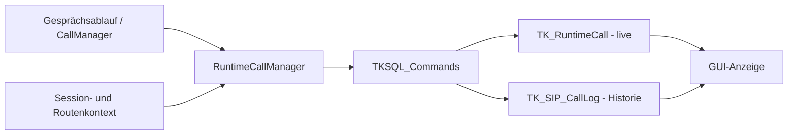

# TKBase_RuntimeCallManager – Aufgabe und Satelliten

Stand: 05.11.2026. Grundlage: aktueller Quellcode im Git-Repository und die vorhandenen UML-Unterlagen.

> **Entwicklungsstand:** Der TK-Server befindet sich im Aufbau und ist noch nicht zu 100 % einsatzbereit. Vorhandene Methoden und aktive Konfiguration bedeuten keine vollständige Funktions- oder Produktionsfreigabe.

## Rolle des Managers

Zentrale Projektion des laufenden Gesprächszustands für die Live-Anzeige und die zugehörige Gesprächshistorie. Er führt Zustandsdaten zusammen, aber entscheidet nicht über Gesprächswege und führt keine SIP-/GSM-Gespräche aus.

## Bezug zu den UML-Unterlagen

Für diesen Manager liegt im UML-Ordner derzeit kein eigenes Diagramm vor. Seine Rolle und die aufgeführten Beziehungen stammen aus dem vorhandenen Quellcode.

Die UML beschreibt die vorgesehene Struktur. Die folgenden Ist-Angaben sind gesondert am Code geprüft. Ein „Satellit“ kann hier ein Bereichsbaustein, ein Datenmodell oder ein Hilfsbaustein sein; die Beziehungsspalte sagt ausdrücklich, ob er direkt verwendet, aufgerufen oder nur fachlich beteiligt ist.

## Satelliten und Beziehungen

| Datei / Baustein | Beziehung zum Manager | Aufgabe im Zusammenspiel |
|---|---|---|
| [TKSQL_Commands.cs](../../SRC/SQL/TKSQL_Commands.cs) | Direkt verwendeter Persistenzsatellit | CreateCallLog, SaveOrUpdateRuntimeCall und Status-/Ende-Operationen. |
| [TKBase_CallManager.cs](../../SRC/BASE/TKBase_CallManager.cs) | Aufrufer / gemeinsame Runtime-Anbindung | Nutzt die RuntimeCall-Verwaltung für Gesprächszustandsänderungen. |
| [TKBase_SessionManager.cs](../../SRC/BASE/TKBase_SessionManager.cs) | Fachlicher Kontextlieferant | Session-ID, Bridge-ID und Leg-IDs stammen aus dem gemeinsamen Gesprächskontext. |
| [TKBase_RoutingManager.cs](../../SRC/BASE/TKBase_RoutingManager.cs) | Ergebnislieferant, nicht zur Neuberechnung | SIPIntResolvedTarget liefert vorhandene Benutzer-/Provider-/GSM-/Service-/Faxinformationen für die Darstellung. |

## Strukturelle Ansicht

Die Darstellung zeigt Zuständigkeiten und Daten-/Aufrufrichtungen. Sie behauptet keinen universellen Event-Bus und keine identische Implementierung aller Bereiche.

## Vorhandene Schnittstellen

- `StartInternalCall(...)`
- `SaveInviteSession(...)`
- `UpdateInviteOutbound(...)`
- `MarkRinging(...)`
- `MarkAnswered(...)`
- `MarkEnded(...)`
- `MarkFailed(...)`

Die vollständigen Parameter und Sichtbarkeiten stehen in [TKBase_RuntimeCallManager.cs](../../SRC/BASE/TKBase_RuntimeCallManager.cs). Die Liste nennt die für diese Rolle wesentlichen Methoden, nicht automatisch alle privaten Hilfsfunktionen.

## Typischer Ablauf

1. Der Gesprächsablauf meldet Session, Legs, Teilnehmer und vorhandenes Routing-Ergebnis.
2. Der Manager löst die zugehörigen Benutzerinformationen für die Darstellung auf.
3. Er erzeugt die Historienzeile und speichert/aktualisiert die zentrale Live-Zeile.
4. Ringing und Answered aktualisieren den gespeicherten Status.
5. Ended/Failed schließen die Historie ab und entfernen den zugehörigen Live-Zustand.

## Im aktuellen Code nachgewiesen

- TK_RuntimeCall ist die Live-Sicht; TK_SIP_CallLog ist die Historie. Beide Tabellen erfüllen unterschiedliche Aufgaben.
- Der aktuelle StartInternalCall-Pfad übergibt sessionId als ersten Schlüssel an CreateCallLog; das Feld SipCallID der Historie ist in diesem Pfad deshalb die Sessionkennung.
- CanHangup/CanTransfer und Teilnehmerdarstellungen sind gespeicherte Bedien-/Anzeigedaten. Sie ersetzen weder die Live-Session noch eine Berechtigungsprüfung im ausführenden Pfad.
- Die GUI liest dieselbe Laufzeit-Datenbasis. Eine zusätzliche GUI-eigene Gesprächsliste wäre nicht die vorgesehene Architektur.

## Zuständigkeitsgrenzen und Soll-Ist-Abgleich

- Keine eigene Zielentscheidung, Sessionerzeugung, Legsteuerung oder Medienausführung.
- Der RuntimeCallManager ist kein untergeordneter SIPInt-/SIPExt-/GSM-Satellit, sondern ein zentraler gemeinsamer Zustandsbaustein.
- Im UML-Ordner gibt es aktuell keine eigene RuntimeCallManager-Datei; die Einordnung erfolgt aus dem Quellcode.

## Daten und Laufzeitzustand

TK_RuntimeCall, TK_SIP_CallLog; TK_SIP_User für Teilnehmerauflösung. Provider-/GSM-Zuordnungen werden aus dem bereits vorliegenden Kontext übernommen.

## Zusammenhang mit den übrigen Managern

- [TKBase_RegistrationManager](TKBase_RegistrationManager_DOKU_AKTUELL.md)
- [TKBase_RoutingManager](TKBase_RoutingManager_DOKU_AKTUELL.md)
- [TKBase_SessionManager](TKBase_SessionManager_DOKU_AKTUELL.md)
- [TKBase_CallManager](TKBase_CallManager_DOKU_AKTUELL.md)
- [TKBase_MediaManager](TKBase_MediaManager_DOKU_AKTUELL.md)
- [TKBase_DTMF_Manager](TKBase_DTMF_Manager_DOKU_AKTUELL.md)
- [TKBase_LogManager](TKBase_LogManager_DOKU_AKTUELL.md)

## Quellen und Prüfumfang

- Manager: [TKBase_RuntimeCallManager.cs](../../SRC/BASE/TKBase_RuntimeCallManager.cs)
- Satelliten: die oben einzeln verlinkten Dateien.
- Geprüft wurden vorhandene Klassen/Methoden, Konstruktorabhängigkeiten und relevante Aufrufstellen. Ein Laufzeit-, Telefonie- oder Installationstest war nicht Teil dieser Dokumentationsarbeit.
- Bestehende UMLs, Dateien unter Alt und Quellcode wurden nicht verändert. Offene Trennungen werden beschrieben und nicht stillschweigend als erledigt dargestellt.
