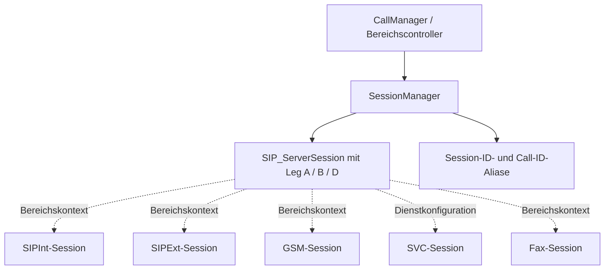

# TKBase_SessionManager – Aufgabe und Satelliten

Stand: 05.11.2026. Grundlage: aktueller Quellcode im Git-Repository und die vorhandenen UML-Unterlagen.

> **Entwicklungsstand:** Der TK-Server befindet sich im Aufbau und ist noch nicht zu 100 % einsatzbereit. Vorhandene Methoden und aktive Konfiguration bedeuten keine vollständige Funktions- oder Produktionsfreigabe.

## Rolle des Managers

Zentrale Ablage und Zuordnung der neutralen Laufzeitsessions mit getrennten Legs A, B und D. Er erzeugt Sessionkontexte, verwaltet Aliase und Lebenszykluszustände. Der in den UMLs gewünschte zentrale Event-/Command-Vermittler ist nicht als vollständige gleichnamige Schnittstelle vorhanden.

## Bezug zu den UML-Unterlagen

- [SessionManager.md](../UML/SessionManager.md)
- [event.hoch.command.runter.md](../UML/event.hoch.command.runter.md)
- [beispiel-call.md](../UML/beispiel-call.md)

Die UML beschreibt die vorgesehene Struktur. Die folgenden Ist-Angaben sind gesondert am Code geprüft. Ein „Satellit“ kann hier ein Bereichsbaustein, ein Datenmodell oder ein Hilfsbaustein sein; die Beziehungsspalte sagt ausdrücklich, ob er direkt verwendet, aufgerufen oder nur fachlich beteiligt ist.

## Satelliten und Beziehungen

| Datei / Baustein | Beziehung zum Manager | Aufgabe im Zusammenspiel |
|---|---|---|
| [TKSipInt_Session.cs](../../SRC/SipInt/TKSipInt_Session.cs) | Bereichsdatenmodell | Eigene interne SIP-Leg-A-/Leg-B-Daten; nicht selbst als protokollausführender Controller zu behandeln. |
| [TKSipExt_Session.cs](../../SRC/SipExt/TKSipExt_Session.cs) | Bereichsdatenmodell | Eigener externer SIP-/Provider-Kontext mit Leg A und B. |
| [TKGSM_Session.cs](../../SRC/GSM/TKGSM_Session.cs) | Bereichsdatenmodell / Projektion | Eigener GSM-Kontext; FromServerSession kann einen neutralen Serverkontext in den Bereichskontext übertragen. |
| [TKSVC_Session.cs](../../SRC/SVC/TKSVC_Session.cs) | Servicekonfiguration / Bereichsdaten | Lädt Dienstinformationen aus SQL; aktueller Live-Servicekontext liegt zusätzlich in SIP_ServerSession.LegD. |
| [TKFax_Session.cs](../../SRC/FAX/TKFax_Session.cs) | Zusätzlicher Fax-Kontext | Vorhandener Fax-Bereich, in den älteren vierteiligen UML-Diagrammen noch nicht vollständig gezeigt. |
| [TKBase_CallManager.cs](../../SRC/BASE/TKBase_CallManager.cs) | Aufrufer / Ablaufkoordination | Verwendet und erzeugt Sessions für die Gesprächsausführung. |
| [TKBase_CallManagerForkingAgent.cs](../../SRC/BASE/TKBase_CallManagerForkingAgent.cs) | Aufrufer / Branch-Koordination | Lässt getrennte Branch-Sessions und Leg-B-Zuordnungen anlegen. |
| [TKSipExt_Routing.cs](../../SRC/SipExt/TKSipExt_Routing.cs) | Ist-Ausnahme im GSM-Monitorpfad | UpsertInboundMonitorSession erzeugt diesen Router derzeit selbst und ruft ResolveInboundTarget auf. |

## Strukturelle Ansicht

Die Darstellung zeigt Zuständigkeiten und Daten-/Aufrufrichtungen. Sie behauptet keinen universellen Event-Bus und keine identische Implementierung aller Bereiche.

## Vorhandene Schnittstellen

- `CreateInviteSession(...)`
- `CreateGsmSession(...)`
- `CreateServiceSession(...)`
- `CreateFaxSession(...)`
- `AttachServiceLegD(...)`
- `CreateGsmInboundForkBranch(...)`
- `TryGet(...)`
- `RegisterAlias(...)`
- `RegisterLegBCallId(...)`
- `MarkAllLegsEnded(...)`
- `Remove(...)`
- `GetSnapshot(...)`

Die vollständigen Parameter und Sichtbarkeiten stehen in [TKBase_SessionManager.cs](../../SRC/BASE/TKBase_SessionManager.cs). Die Liste nennt die für diese Rolle wesentlichen Methoden, nicht automatisch alle privaten Hilfsfunktionen.

## Typischer Ablauf

1. Der Gesprächsablauf übergibt den bekannten Anruferkontext und das aufgelöste Ziel.
2. Der Manager erzeugt die passenden Leg-Call-IDs und bildet die SessionID aus Leg A plus Leg B beziehungsweise Leg D.
3. SessionID und Call-ID-Aliase werden in den zentralen Dictionaries hinterlegt.
4. Bereichsabläufe verwenden denselben Gesprächskontext und aktualisieren getrennte Legzustände.
5. Zum Ende werden Legs als beendet markiert und Session samt Aliaszuordnungen entfernt.

## Im aktuellen Code nachgewiesen

- SIP_ServerSession sowie SIP_ServerLegA, SIP_ServerLegB und SIP_ServerLegD sind im aktuellen Code in derselben Datei definiert.
- Der Manager verwendet ConcurrentDictionary für Sessions und Aliase; GetSnapshot liefert eine Momentaufnahme dieser Service-Laufzeitdaten. Das ist keine GUI-Schattenliste.
- Die Session-ID entsteht aktuell als MD5-basierte GUID aus Leg-A-Call-ID, Trennzeichen und Ziel-Leg-Call-ID, ohne Bindestriche. Die Bridge-GUID wird getrennt gebildet.
- Die zentrale UML-Schnittstelle NotifyPeerTrying, NotifyPeerRinging, NotifyPeerAnswered, RequestPeerHangup usw. ist im aktuellen SessionManager nicht implementiert. Diese Namen dürfen nicht als vorhandene Methoden ausgegeben werden.
- UpsertInboundMonitorSession enthält einen direkten TKSipExt_Routing-Aufruf. Das weicht von der angestrebten vollständigen Trennung zwischen Sessionverwaltung und fachlicher Routensuche ab.

## Zuständigkeitsgrenzen und Soll-Ist-Abgleich

- UML-Leitbild: SessionManager ordnet Bereiche/Legs zu; Sessions halten Gesprächskontext, Controller führen aus, Commands gehen nach unten und Events melden zurück.
- Ist: Ein wesentlicher Teil der Ablauf- und Ereigniskoordination liegt derzeit im CallManager und den Bereichscontrollern.
- TKSVC_Session ist im aktuellen Code vor allem ein Dienst-Konfigurationsmodell; es bildet nicht allein den gesamten Live-Leg-D-Zustandsautomaten.
- Neue Routing- oder Protokollzuständigkeiten werden durch diese Beschreibung nicht eingeführt.

## Daten und Laufzeitzustand

Primär In-Memory-Servicezustand. Die getrennte DB-Live-Sicht TK_RuntimeCall wird über den RuntimeCallManager gepflegt.

## Zusammenhang mit den übrigen Managern

- [TKBase_RegistrationManager](TKBase_RegistrationManager_DOKU_AKTUELL.md)
- [TKBase_RoutingManager](TKBase_RoutingManager_DOKU_AKTUELL.md)
- [TKBase_CallManager](TKBase_CallManager_DOKU_AKTUELL.md)
- [TKBase_RuntimeCallManager](TKBase_RuntimeCallManager_DOKU_AKTUELL.md)
- [TKBase_MediaManager](TKBase_MediaManager_DOKU_AKTUELL.md)
- [TKBase_DTMF_Manager](TKBase_DTMF_Manager_DOKU_AKTUELL.md)
- [TKBase_LogManager](TKBase_LogManager_DOKU_AKTUELL.md)

## Quellen und Prüfumfang

- Manager: [TKBase_SessionManager.cs](../../SRC/BASE/TKBase_SessionManager.cs)
- Satelliten: die oben einzeln verlinkten Dateien.
- Geprüft wurden vorhandene Klassen/Methoden, Konstruktorabhängigkeiten und relevante Aufrufstellen. Ein Laufzeit-, Telefonie- oder Installationstest war nicht Teil dieser Dokumentationsarbeit.
- Bestehende UMLs, Dateien unter Alt und Quellcode wurden nicht verändert. Offene Trennungen werden beschrieben und nicht stillschweigend als erledigt dargestellt.
